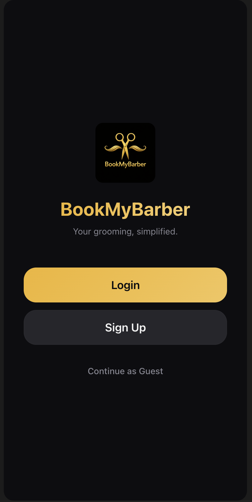
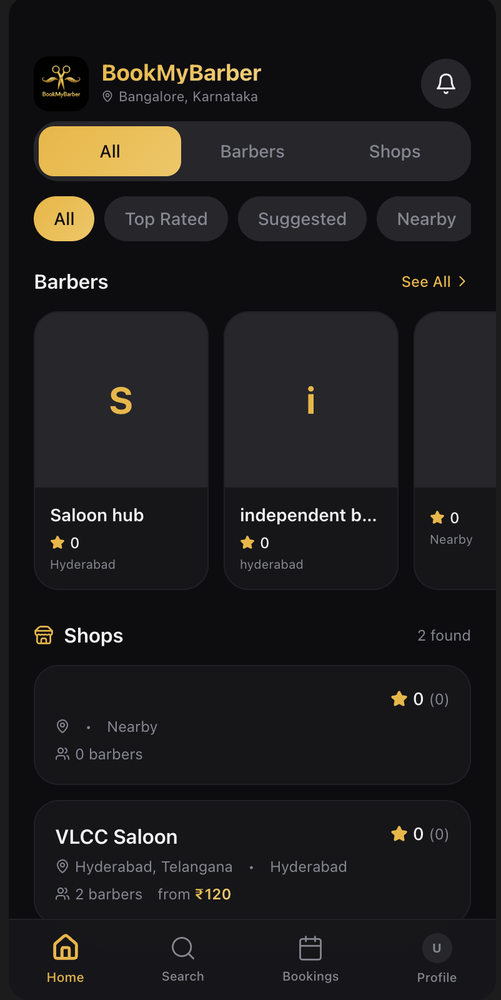
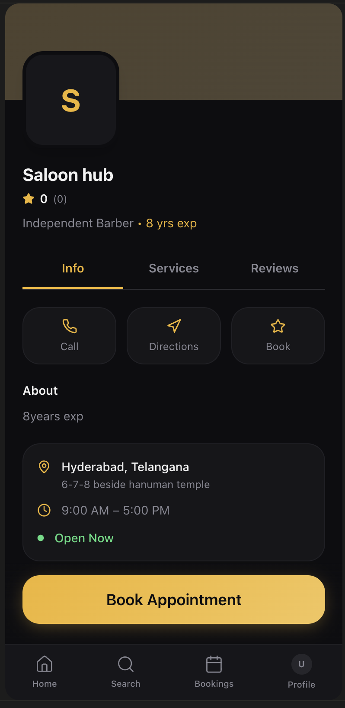
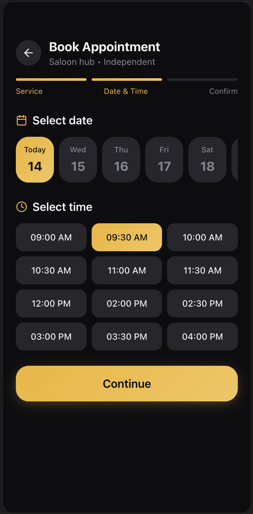
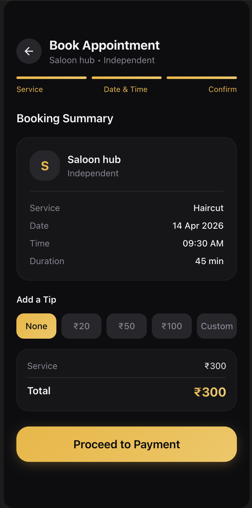
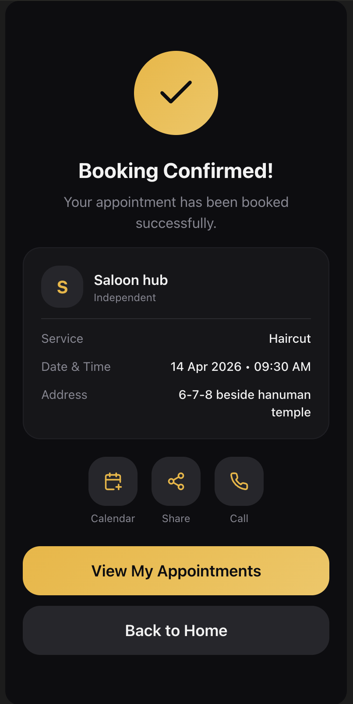
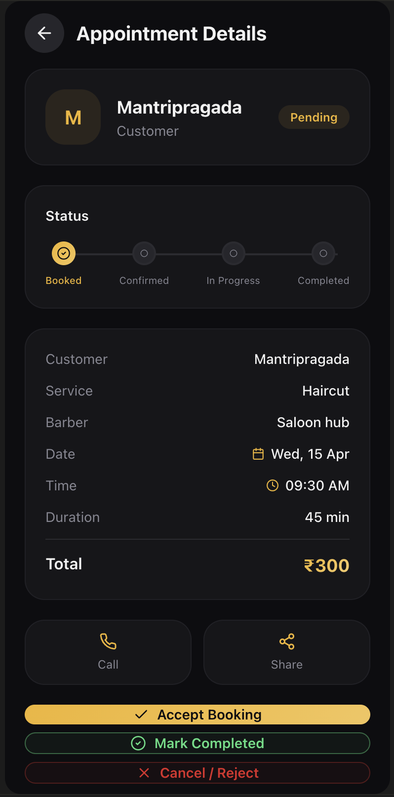
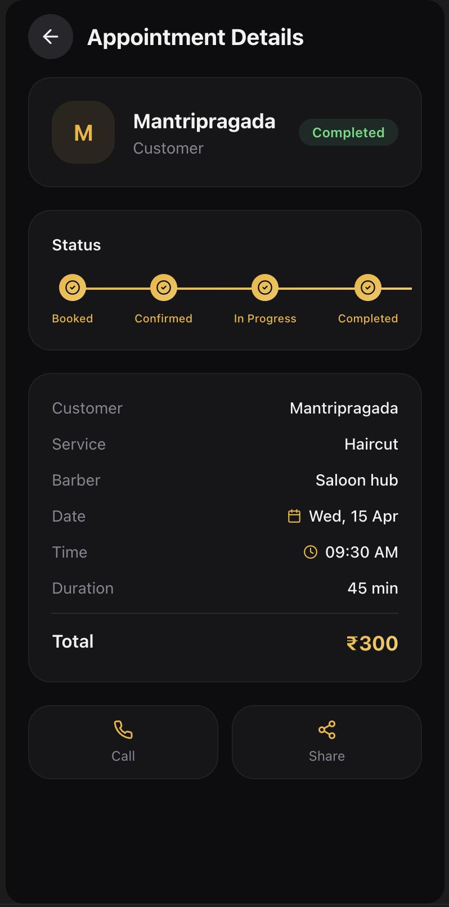

# 💈 BookMyBarber

A modern multi-role appointment booking platform for barbers, salon owners, and customers.

🔗 Live Demo: https://bookmybarber.co/

## 🚀 Overview
BookMyBarber is a multi-role appointment booking platform designed to connect customers, barbers, and shop owners.

The system supports real-time booking, walk-in management, and role-based dashboards to streamline operations for barber shops.

---

## 🎯 Demo Flow

1. Login or continue as guest  
2. Browse barbers or shops  
3. Select a barber/shop  
4. Book appointment (date & time)  
5. Confirm booking  
6. View booking in dashboard  
7. Manage appointment (accept / complete / cancel)

## 👥 User Roles

### Customer
- Browse barbers and shops
- Book appointments
- View and manage bookings

### Shop Owner
- Manage shop details
- Add/remove barbers
- View and manage all bookings
- Handle walk-in customers

### Independent Barber
- Manage personal schedule
- Accept/reject bookings
- Track appointments

---

## ✨ Key Features

- Role-based dashboards (Customer / Owner / Barber)
- Appointment booking system
- Walk-in booking support
- Booking status management (accept, cancel, reschedule)
- Client management system
- Notification handling
- Profile switching between roles

---

## 🧠 My Contribution

- Designed full system architecture and user flows
- Implemented role-based access and dashboard logic
- Built booking workflow from scratch (end-to-end)
- Integrated AI-assisted development tools to accelerate development and debugging
- Validated product idea with real barber shops and iterated based on feedback

---

## 🛠 Tech Stack

### Frontend
- React  
- TypeScript  
- Vite  
- Tailwind CSS  
- shadcn/ui  

### Application Architecture
- Role-based access control (Customer / Shop Owner / Independent Barber)
- Client-side routing and dynamic rendering
- Component-based architecture
- State management for booking workflows and UI interactions

### Backend & Data Handling
- API-driven architecture (tool-managed backend services)
- CRUD operations for bookings, users, and shop data
- Authentication and session handling
- Real-time state updates for booking lifecycle

### AI & Development Approach
- AI-assisted development (LLMs, prompt engineering)
- Rapid prototyping and iterative development using AI tools
- Debugging and feature generation using AI workflows

### Dev Tools & Workflow
- Git & GitHub  
- Version control and repository management  
- Agile-style iterative development  

### Deployment
- Cloud-based deployment via Lovable platform  
- Web-based hosting and live preview environment  

## 🤖 AI Tools & Development Approach

### AI Tools Used
- GPT-4 / ChatGPT (OpenAI)  
- Claude (Anthropic)  
- GitHub Copilot  
- Cursor AI  

### AI Capabilities
- Prompt Engineering for structured feature development  
- AI-assisted code generation and debugging  
- Rapid prototyping using LLMs  
- Iterative development using AI-driven workflows  

### Application in This Project
- Accelerated UI and feature development using AI tools  
- Designed and implemented booking workflows with AI-assisted iteration  
- Debugged and optimized components using AI-based suggestions  

---

## ⚙️ Architecture

Frontend handles UI and role-based routing, while backend services manage booking data, user roles, and state persistence.

## 🔗 Live Demo

👉 https://bookmybarberbmb.lovable.app

---
## 📸 Screenshots

### Login Screen  

### Customer Home  

### Barber Profile  

### Booking – Select Time  

### Booking – Summary  

### Booking – Confirmation  

### Owner Dashboard  

### Appointment (Pending)  

### Appointment (Completed)  

---

## 💡 Learnings

- Real-world validation showed that walk-in behavior dominates in many markets
- Importance of adapting product based on user behavior
- Building scalable role-based systems

---

## ⚡ Note

This project was built using modern AI-assisted development tools to rapidly prototype and iterate on a real-world product idea.
